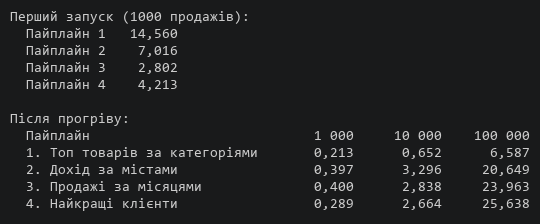
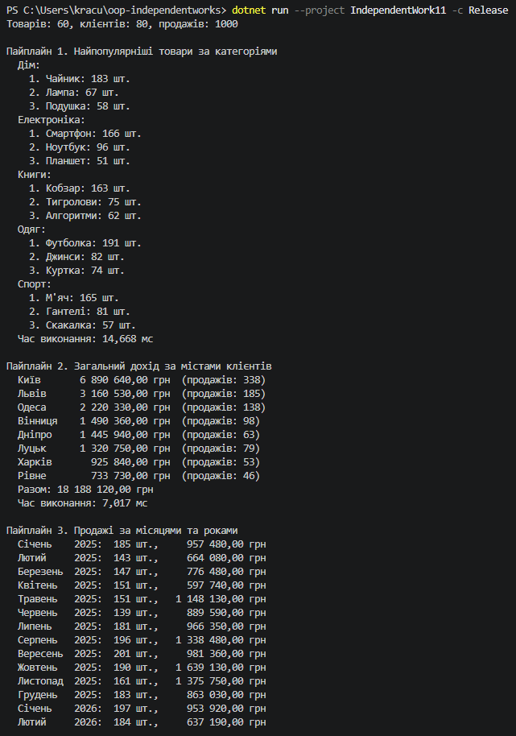
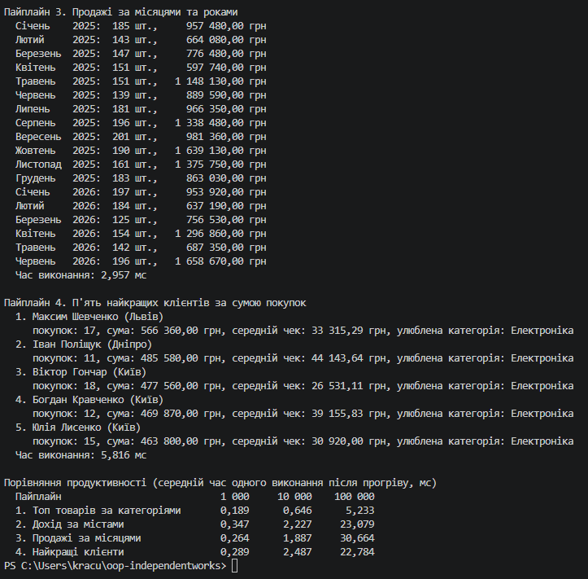

# Звіт до самостійної роботи №11

Тема: LINQ pipelines, ETL та аналітика.

## Що є в проєкті

- `Product.cs`, `Customer.cs`, `Sale.cs`: сутності сценарію «Продажі».
- `SalesData.cs`: генерація тестових даних.
- `SalesAnalytics.cs`: чотири LINQ-пайплайни, кожен в окремому методі.
- `Program.cs`: запуск пайплайнів, вивід результатів і вимірювання часу.

## Тестові дані

Дані генеруються через `Random` з фіксованим зерном (2026), тому при кожному запуску вони однакові і результати можна перевірити повторно.

- **60 товарів:** 5 категорій (Електроніка, Книги, Одяг, Спорт, Дім) по 12 товарів, у кожної категорії свій діапазон цін.
- **80 клієнтів** з 8 міст.
- **1000 продажів** з 1 січня 2025 до 30 червня 2026, від 1 до 5 штук у кожному.

Щоб дані були схожі на справжні, я зробив їх нерівномірними. Перші товари в кожній категорії купують частіше, а перші міста зі списку (Київ, Львів) мають більше клієнтів. Інакше всі товари продавалися б приблизно однаково, і «найпопулярніші товари» нічого б не показували.

У термінах ETL генерація даних є етапом Extract. Пайплайни перетворюють дані (Transform) і складають результат у список (Load), який потім виводиться.

## Опис пайплайнів

### Пайплайн 1. Найпопулярніші товари за категоріями

**Мета:** у кожній категорії знайти 3 товари, яких продали найбільше штук.

```csharp
return _data.Sales
    .GroupBy(s => s.ProductId)
    .Select(g => new { ProductId = g.Key, TotalQuantity = g.Sum(s => s.Quantity) })
    .Join(_data.Products,
          stat => stat.ProductId,
          product => product.Id,
          (stat, product) => new { product.Name, product.Category, stat.TotalQuantity })
    .GroupBy(x => x.Category)
    .Select(g => new CategoryTopProducts(
        g.Key,
        g.OrderByDescending(x => x.TotalQuantity)
         .ThenBy(x => x.Name)
         .Take(topCount)
         .Select(x => new ProductSales(x.Name, x.TotalQuantity))
         .ToList()))
    .OrderBy(c => c.Category)
    .ToList();
```

**Оператори і чому саме вони:**

- `GroupBy` + `Sum` збирають 1000 продажів у 60 рядків, по одному на товар, із загальною кількістю.
- `Join` додає до кожного рядка назву і категорію товару. Я зробив його після групування, а не до. Так з'єднується лише 60 рядків замість 1000, і пайплайн працює швидше.
- Другий `GroupBy` групує вже за категорією.
- `OrderByDescending` + `Take(3)` дають трійку лідерів у кожній категорії. `ThenBy(x => x.Name)` потрібен на випадок, якщо в двох товарів однакова кількість: тоді порядок не випадковий, а за алфавітом.

### Пайплайн 2. Загальний дохід за містами клієнтів

**Мета:** порахувати, скільки грошей принесли клієнти з кожного міста, і відсортувати міста від найприбутковішого.

Цей пайплайн я записав синтаксисом запитів (query syntax). З двома `join` він читається легше, ніж ланцюжок методів:

```csharp
var query =
    from sale in _data.Sales
    join product in _data.Products on sale.ProductId equals product.Id
    join customer in _data.Customers on sale.CustomerId equals customer.Id
    let revenue = sale.Quantity * product.UnitPrice
    group revenue by customer.City into cityGroup
    orderby cityGroup.Sum() descending
    select new CityRevenue(cityGroup.Key, cityGroup.Sum(), cityGroup.Count());
```

**Оператори і чому саме вони:**

- Два `join`: ціна є лише в товарі, а місто лише в клієнті, тому продаж треба з'єднати з обома таблицями.
- `let` зберігає обчислений дохід, щоб не писати формулу `Quantity * UnitPrice` кілька разів.
- `group ... by` групує за містом, а `orderby ... descending` сортує за доходом від більшого до меншого.

Сума доходів за всіма містами 18 188 120 грн, а сума продажів за містами дорівнює 1000. Так я перевірив, що жоден продаж не загубився під час з'єднання.

### Пайплайн 3. Продажі за місяцями та роками

**Мета:** для кожного місяця порахувати, скільки одиниць продано і який дохід.

```csharp
return _data.Sales
    .Join(_data.Products,
          sale => sale.ProductId,
          product => product.Id,
          (sale, product) => new
          {
              sale.SaleDate,
              sale.Quantity,
              Revenue = sale.Quantity * product.UnitPrice
          })
    .GroupBy(x => new { x.SaleDate.Year, x.SaleDate.Month })
    .Select(g => new MonthlySales(
        g.Key.Year,
        g.Key.Month,
        g.Sum(x => x.Quantity),
        g.Sum(x => x.Revenue)))
    .OrderBy(m => m.Year)
    .ThenBy(m => m.Month)
    .ToList();
```

**Оператори і чому саме вони:**

- `Join` з товарами потрібен, щоб отримати ціну для обчислення доходу.
- `GroupBy` з анонімним типом `new { Year, Month }` групує одразу за двома полями. Групувати лише за `Month` не можна, бо тоді січень 2025 і січень 2026 потрапили б в одну групу. Анонімні типи порівнюються за значеннями полів, тому такий ключ працює правильно.
- `OrderBy` + `ThenBy` сортують спочатку за роком, потім за місяцем.

### Пайплайн 4 (власний). Найкращі клієнти

**Мета:** знайти 5 клієнтів, які витратили найбільше, і для кожного показати кількість покупок, середній чек і улюблену категорію. Такий звіт міг би знадобитися магазину, щоб пропонувати знижки постійним клієнтам.

```csharp
return _data.Sales
    .Join(_data.Products, /* ... */ (sale, product) => new
    {
        sale.CustomerId,
        product.Category,
        Amount = sale.Quantity * product.UnitPrice
    })
    .GroupBy(x => x.CustomerId)
    .Select(g => new
    {
        CustomerId = g.Key,
        Purchases = g.Count(),
        TotalSpent = g.Sum(x => x.Amount),
        FavoriteCategory = g.GroupBy(x => x.Category)
                            .OrderByDescending(c => c.Sum(x => x.Amount))
                            .First()
                            .Key
    })
    .OrderByDescending(x => x.TotalSpent)
    .Take(topCount)
    .Join(_data.Customers, /* ... */ (stat, customer) => new CustomerSummary(/* ... */))
    .ToList();
```

**Використані оператори:** `Join` (двічі), `GroupBy` (двічі, один усередині іншого), `Select`, `Count`, `Sum`, `OrderByDescending`, `Take`, `First`.

**Що тут цікавого:**

- Улюблена категорія рахується вкладеним `GroupBy` усередині групи клієнта: покупки одного клієнта групуються за категорією і береться та, на яку він витратив найбільше.
- З'єднання з клієнтами (`Join`) стоїть у самому кінці, після `Take(5)`. Ім'я і місто потрібні лише для п'яти клієнтів, тож нема сенсу з'єднувати всі 80.

У всіх п'яти найкращих клієнтів улюблена категорія Електроніка. Спершу я подумав, що це помилка, але це логічно: електроніка коштує до 40 000 грн, а книги до 900 грн. Хто купує електроніку, той і витрачає найбільше.

## Вимірювання продуктивності

Для кожного пайплайну створюється свій `Stopwatch`. Я вимірював двома способами:

1. **Перший запуск** кожного пайплайну на 1000 продажів, разом з виводом результатів.
2. **Середній час після прогріву:** пайплайн спочатку виконується 3 рази вхолосту, а потім вимірюється середнє з кількох повторів. Я виміряв це на трьох обсягах: 1000, 10 000 і 100 000 продажів (60 товарів і 80 клієнтів ті самі).

Результати (мс):



Я запускав програму кілька разів. Цифри щоразу трохи відрізняються, бо на комп'ютері працюють інші програми, але співвідношення залишаються такими самими.

## Аналіз результатів

**1. Перший запуск у десятки разів повільніший.** Пайплайн 1 вперше виконався за 14,6 мс, а після прогріву за 0,2 мс, тобто приблизно в 70 разів швидше. Причина в JIT-компіляції: .NET перетворює код на машинні команди лише тоді, коли він вперше потрібен. LINQ-методи узагальнені, і для кожного нового типу (а в мене багато анонімних типів) їх треба компілювати окремо. Пайплайн 1 запускається першим, тому платить за компіляцію найбільше. Пайплайни 2–4 частково використовують уже скомпільований код. Отже, якщо вимірювати тільки перший запуск, можна зробити хибний висновок, що пайплайн 1 найповільніший, хоча насправді він найшвидший.

**2. Час росте пропорційно кількості даних.** Для пайплайнів 2–4 при збільшенні продажів у 10 разів час теж зростає приблизно в 7–10 разів. Це логічно: кожен пайплайн один раз проходить усі продажі, тобто працює за O(n).

**3. Пайплайн 1 найшвидший, бо одразу зменшує дані.** На 100 000 продажів він працює 6,6 мс, а інші 20–26 мс. Він спочатку групує продажі за товаром (лишається 60 рядків), а все інше, включно з `Join`, робить уже з ними. Інші пайплайни роблять `Join` для кожного з 100 000 продажів і створюють для кожного новий анонімний об'єкт. Звідси висновок: що раніше в пайплайні зменшити кількість даних (`Where`, `GroupBy`), то швидше працюватимуть наступні кроки.

**4. На маленьких обсягах помітні постійні витрати.** Для пайплайну 1 перехід від 1000 до 10 000 продажів збільшив час лише втричі, а не вдесятеро. При 1000 продажах значну частину часу займає робота, що не залежить від кількості продажів: з'єднання 60 товарів, сортування, створення списків.

**Що ще впливає на час:**

- **`Join`:** LINQ будує хеш-таблицю для другої колекції, тому `Join` працює за O(n + m), а не O(n · m). Якби замість нього в `Select` шукати товар через `_data.Products.First(p => p.Id == ...)`, кожен пошук перебирав би список, і на 100 000 продажів це було б значно повільніше.
- **Відкладене виконання:** LINQ-запит нічого не робить, поки результат не почнуть перебирати. Тому кожен мій метод закінчується `.ToList()`, інакше `Stopwatch` виміряв би лише створення запиту, а не його виконання. Ще одна пастка: якщо результат без `ToList()` перебрати двічі, запит виконається двічі.
- **Створення об'єктів:** кожен `Select` з `new { ... }` створює новий об'єкт для кожного елемента, а це навантаження на пам'ять і збирач сміття.
- **`decimal`:** обчислення з `decimal` повільніші, ніж з `double`. Але для грошей потрібен саме `decimal`, бо `double` дає помилки округлення.
- **Режим збірки:** у Debug оптимізації вимкнені, тому вимірювати треба в Release.

## Висновки

LINQ добре підходить для ETL та аналітики. Кожен пайплайн займає 10–20 рядків і читається майже як опис задачі: «згрупуй за товаром, порахуй суму, з'єднай з товарами, згрупуй за категорією, візьми топ-3». Те саме через цикли `foreach` і словники зайняло б у кілька разів більше коду, і в ньому було б легше помилитися.

Швидкодії LINQ для таких обсягів більш ніж достатньо: 100 000 продажів обробляються за 6–26 мс. Ручні цикли могли б бути трохи швидшими, бо не створюють проміжних об'єктів, але для аналітичних звітів така різниця не важлива, а читабельність важлива.

Головне, що я зрозумів про продуктивність LINQ:

- порядок операторів має значення: краще спочатку зменшити дані (`GroupBy`, `Where`, `Take`), а вже потім робити `Join` і `Select`;
- для з'єднання таблиць треба використовувати `Join`, а не пошук у циклі;
- завжди закінчувати пайплайн `ToList()`, якщо результат потрібен кілька разів або треба виміряти час;
- для чесного вимірювання треба прогрівати код і запускати Release-збірку.

Щоб пайплайн залишався читабельним, я виніс кожен в окремий метод з промовистою назвою, додав коментарі до кроків, а для результатів зробив окремі типи `record` з зрозумілими назвами полів. Правильність я перевіряв контрольними сумами: кількість продажів за всіма містами дорівнює 1000, а загальний дохід за містами (пайплайн 2) і за місяцями (пайплайн 3) однаковий, 18 188 120 грн, хоча рахується різними шляхами.

## Повний вивід програми



