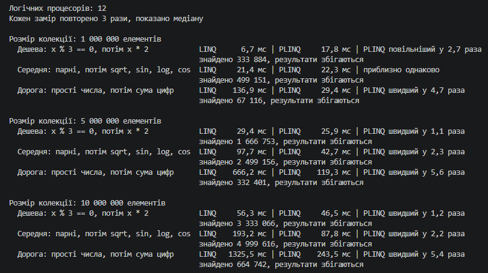
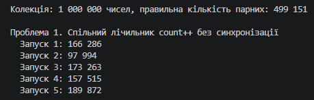
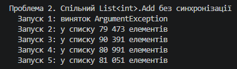
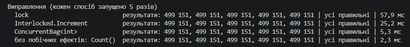
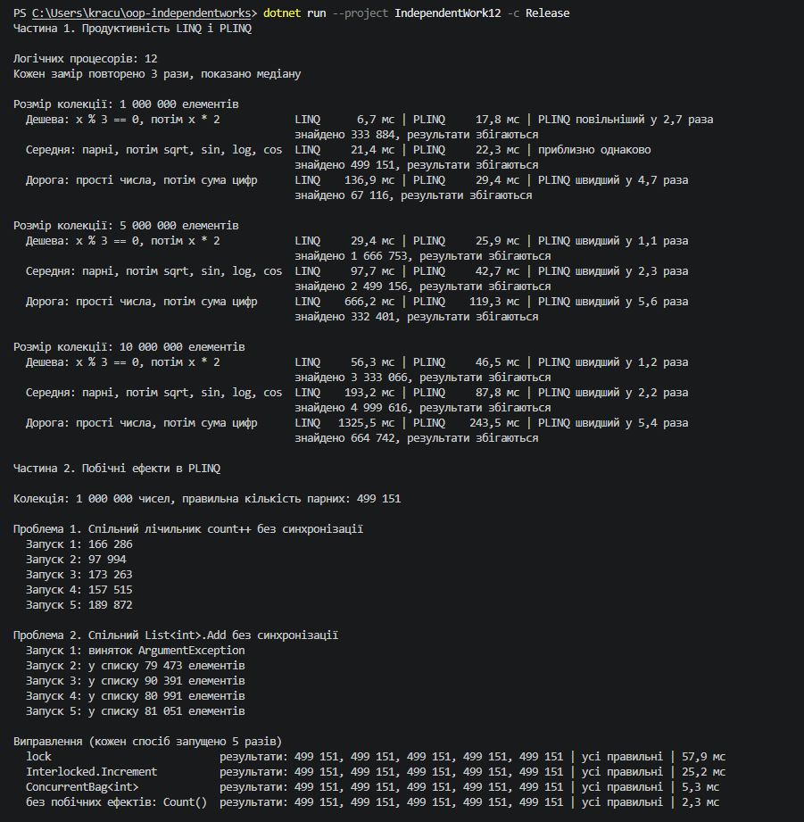

# Звіт до самостійної роботи №12

Тема: PLINQ, дослідження продуктивності та безпеки.

## 1. Експерименти з продуктивності

**Колекція:** `List<int>` з випадковими числами від 1 до 10 000 000 (фіксоване зерно `Random`). Розміри: 1, 5 і 10 мільйонів елементів.

**Обчислювальні операції:**

1. дешева: `x % 3 == 0`, потім `x * 2`;
2. середня: парні числа, потім `Math.Sqrt`, `Sin`, `Log`, `Cos`;
3. дорога: перевірка на просте число перебором дільників, потім сума цифр.

Кожна операція виконується через LINQ (`.Where(...).Select(...)`) і через PLINQ (`.AsParallel().Where(...).Select(...)`), час вимірюється `Stopwatch`. Перед замірами код прогрівається, кожен замір повторюється 3 рази і береться медіана. Програма перевіряє, що обидва способи дали однаковий результат. Комп'ютер має 12 логічних процесорів.

**Результати:**



## 2. Коли PLINQ швидший, а коли ні

- **Дешева операція:** на 1 млн PLINQ повільніший у 2,7 раза, на 5 і 10 млн швидший лише в 1,1–1,2 раза. Робота з одним елементом займає наносекунди, а PLINQ витрачає час на розподіл колекції між потоками і на збирання результатів в один список. Ці витрати більші за економію.
- **Середня операція:** на 1 млн однаково, на 5 і 10 млн PLINQ швидший у 2,2–2,3 раза. Накладні витрати PLINQ майже постійні, тому на більших колекціях вони стають меншою часткою загального часу.
- **Дорога операція:** PLINQ швидший завжди, у 4,7–5,6 раза. Кожен елемент вимагає сотень ділень, тому накладні витрати непомітні.

Прискорення не досягає 12 разів, бо 12 логічних процесорів означають 6 фізичних ядер з двома потоками на кожному. Крім того, частини колекції мають різну складність, і потоки, що закінчили раніше, чекають на інші, а результати треба об'єднати.

## 3. Побічні ефекти

Якщо лямбда в PLINQ змінює спільну змінну, вона робить це одночасно з 12 потоків. Для демонстрації я рахував парні числа в 1 млн елементів (правильна відповідь 499 151).

**Проблема 1: спільний лічильник.**

```csharp
int count = 0;
data.AsParallel().ForAll(x =>
{
    if (x % 2 == 0)
    {
        count++;
    }
});
```



Кожен запуск дає інше і завжди неправильне число. `count++` складається з трьох кроків: прочитати, додати 1, записати. Якщо два потоки одночасно прочитали те саме значення, одне збільшення губиться. Це називається гонкою (race condition).

**Проблема 2: спільний `List<int>`.**

```csharp
List<int> evens = new List<int>();
data.AsParallel().Where(x => x % 2 == 0).ForAll(x => evens.Add(x));
```



`List<T>` не потокобезпечний. Коли він збільшує внутрішній масив, інші потоки пишуть у старий масив або за його межі. Тому список губить елементи або програма падає з винятком.

**Виправлення:**

```csharp
// 1. lock: лише один потік одночасно виконує count++
lock (locker) { count++; }

// 2. Interlocked: атомарне збільшення без блокування
Interlocked.Increment(ref count);

// 3. Потокобезпечна колекція замість List<T>
ConcurrentBag<int> evens = new ConcurrentBag<int>();

// 4. Без побічних ефектів: PLINQ сам безпечно об'єднує результати потоків
data.AsParallel().Count(x => x % 2 == 0);
```



Усі чотири способи дають правильну відповідь, але з різною швидкістю. `lock` найповільніший, бо потоки стоять у черзі до одного замка. `Interlocked` удвічі швидший, бо не блокує потоки. `ConcurrentBag` ще швидший, бо в кожного потоку свій внутрішній список. Найкращий спосіб четвертий: без спільних змінних узагалі, він найшвидший і найпростіший.

## 4. Висновки

- PLINQ доцільний, коли операція над кожним елементом дорога і елементів багато. Для дешевих операцій він не дає виграшу або навіть сповільнює роботу.
- Порівнювати треба на кількох розмірах і операціях. Один тест може дати протилежний висновок: на 1 млн дешевої операції PLINQ повільніший, а на дорогій швидший у 5 разів.
- Якщо PLINQ виявився повільнішим, краще залишити звичайний LINQ.
- Головна небезпека PLINQ в побічних ефектах: такий код компілюється без попереджень, але дає щоразу іншу неправильну відповідь. Лямбди в PLINQ мають лише обчислювати результат. Якщо спільний стан неминучий, потрібні `Interlocked`, потокобезпечні колекції або `lock`.

## Повний вивід програми


