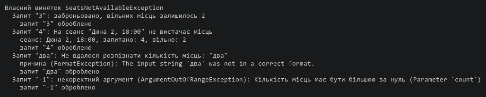
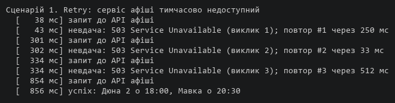
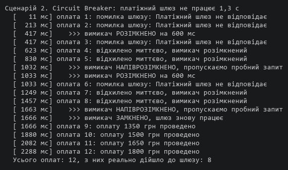
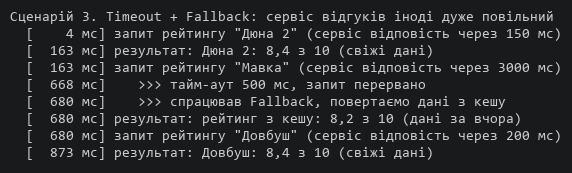

# Звіт до самостійної роботи №19

Тема: дизайн винятків і політики retry, теорія та кейси Polly.

Усі сценарії стосуються однієї предметної області: онлайн-продажу квитків у кінотеатр. Для Polly використано пакет `Polly.Core` 8.9.1 з актуальним API `ResiliencePipelineBuilder`. Зовнішні сервіси, що дають збої, імітуються класами у файлі `FakeServices.cs`.

## Власний тип винятку

`SeatsNotAvailableException` викидається, коли на сеанс не вистачає вільних місць. Крім трьох стандартних конструкторів, у нього є додатковий конструктор і властивості `SessionName`, `RequestedSeats`, `AvailableSeats`. За ними код, що перехопив виняток, може показати користувачу, скільки місць залишилось.

```csharp
public class SeatsNotAvailableException : Exception
{
    public string SessionName { get; } = string.Empty;
    public int RequestedSeats { get; }
    public int AvailableSeats { get; }

    public SeatsNotAvailableException() { }
    public SeatsNotAvailableException(string message) : base(message) { }
    public SeatsNotAvailableException(string message, Exception innerException) : base(message, innerException) { }

    public SeatsNotAvailableException(string message, string sessionName, int requestedSeats, int availableSeats)
        : base(message)
    {
        SessionName = sessionName;
        RequestedSeats = requestedSeats;
        AvailableSeats = availableSeats;
    }
}
```

У `Main` чотири запити на бронювання обробляються блоками `catch` від найконкретнішого до найзагальнішого, а `finally` спрацьовує завжди. Для запиту «два» `int.Parse` викидає `FormatException`, і я загортаю його в `SeatsNotAvailableException` через конструктор з `innerException`, щоб не загубити початкову причину.



## Сценарій 1. Retry: сервіс афіші тимчасово недоступний

**Проблема.** Розклад сеансів завантажується із зовнішнього API. Іноді він кілька секунд відповідає помилкою 503, наприклад під час перезапуску. Якщо одразу показати користувачу помилку, він піде, хоча через пів секунди сервіс уже працював би.

**Стратегія: Retry з експоненційною затримкою і jitter.** Збій тимчасовий, тому має сенс просто спробувати ще раз. Затримка між спробами росте (200 → 400 → 800 мс), щоб не навантажувати сервіс, який і так перевантажений. Jitter робить затримку трохи випадковою: якщо тисячі клієнтів отримали помилку одночасно, вони не повторюватимуть запит теж одночасно. Повторюються лише `HttpRequestException`, бо помилку в нашому коді повтор не виправить.

```csharp
ResiliencePipeline pipeline = new ResiliencePipelineBuilder()
    .AddRetry(new RetryStrategyOptions
    {
        ShouldHandle = new PredicateBuilder().Handle<HttpRequestException>(),
        MaxRetryAttempts = 4,
        Delay = TimeSpan.FromMilliseconds(200),
        BackoffType = DelayBackoffType.Exponential,
        UseJitter = true,
        OnRetry = args =>
        {
            Log(clock, $"невдача: {args.Outcome.Exception?.Message}; " +
                       $"повтор #{args.AttemptNumber + 1} через {args.RetryDelay.TotalMilliseconds:F0} мс");
            return default;
        }
    })
    .Build();
```



**Опис виводу.** API тричі відповів 503, і після кожної невдачі Polly чекав і повторював запит. Четверта спроба вдалася, і користувач отримав розклад. Затримки вийшли 250, 33 і 512 мс, а не точно 200, 400 і 800. Це і є jitter: Polly бере випадкову затримку навколо експоненційної кривої, тому окрема затримка може бути меншою за попередню, але в середньому вони ростуть.

## Сценарій 2. Circuit Breaker: платіжний шлюз не працює

**Проблема.** Платіжний шлюз «впав» і не працює 1,3 секунди. Якщо кожна оплата робитиме ще й кілька повторів, на і так непрацюючий сервіс полетить лавина запитів. Він довше відновлюватиметься, а користувачі чекатимуть таймаутів.

**Стратегія: Circuit Breaker.** Retry тут шкідливий, бо збій не короткочасний. Вимикач після кількох невдач розмикається, і наступні запити відхиляються миттєво, навіть не доходячи до шлюзу. Через `BreakDuration` він пропускає один пробний запит. Якщо той успішний, вимикач замикається, а якщо ні, знову розмикається.

```csharp
ResiliencePipeline pipeline = new ResiliencePipelineBuilder()
    .AddCircuitBreaker(new CircuitBreakerStrategyOptions
    {
        ShouldHandle = new PredicateBuilder().Handle<InvalidOperationException>(),
        FailureRatio = 0.5,
        MinimumThroughput = 3,
        SamplingDuration = TimeSpan.FromSeconds(5),
        BreakDuration = TimeSpan.FromMilliseconds(600),
        OnOpened = args => { Log(clock, "   >>> вимикач РОЗІМКНЕНО ..."); return default; },
        OnHalfOpened = args => { Log(clock, "   >>> вимикач НАПІВРОЗІМКНЕНО ..."); return default; },
        OnClosed = args => { Log(clock, "   >>> вимикач ЗАМКНЕНО ..."); return default; }
    })
    .Build();

try
{
    string result = pipeline.Execute(() => gateway.Charge(150m * i));
}
catch (BrokenCircuitException)
{
    // Запит навіть не дійшов до шлюзу
}
```



**Опис виводу.** У виводі видно всі три стани вимикача:

- **Замкнений (Closed):** оплати 1–3 доходять до шлюзу і падають. Після третьої невдачі (3 з 3 запитів невдалі, а поріг 50%) вимикач розмикається.
- **Розімкнений (Open):** оплати 4–5 відхиляються миттєво, шлюз їх навіть не бачить.
- **Напіврозімкнений (Half-Open):** через 600 мс пропускається пробна оплата 6. Шлюз ще не працює, тому вимикач знову розмикається. Наступна пробна оплата 9 проходить успішно, вимикач замикається, і далі все працює.

Підсумок: з 12 оплат до шлюзу дійшло лише 8, і непрацюючий сервіс отримав менше навантаження.

## Сценарій 3. Timeout + Fallback: повільний сервіс відгуків

**Проблема.** Біля кожного фільму показується рейтинг глядачів зі стороннього сервісу відгуків. Іноді він відповідає 3 секунди замість 0,2. Через нього вся сторінка вантажилася б 3 секунди, хоча рейтинг не найважливіша її частина.

**Стратегія: Timeout + Fallback.** Timeout перериває запит, який триває довше 500 мс. Fallback замість помилки повертає запасне значення, тобто рейтинг з кешу (вчорашні дані). Користувач бачить трохи застарілий рейтинг, зате швидко. Fallback додано першим, тому він зовнішній і перехоплює `TimeoutRejectedException` від внутрішньої стратегії Timeout.

```csharp
ResiliencePipeline<string> pipeline = new ResiliencePipelineBuilder<string>()
    .AddFallback(new FallbackStrategyOptions<string>
    {
        ShouldHandle = new PredicateBuilder<string>().Handle<TimeoutRejectedException>(),
        FallbackAction = args => Outcome.FromResultAsValueTask("рейтинг з кешу: 8,2 з 10 (дані за вчора)"),
        OnFallback = args => { Log(clock, "   >>> спрацював Fallback ..."); return default; }
    })
    .AddTimeout(new TimeoutStrategyOptions
    {
        Timeout = TimeSpan.FromMilliseconds(500),
        OnTimeout = args => { Log(clock, "   >>> тайм-аут ..."); return default; }
    })
    .Build();

string rating = await pipeline.ExecuteAsync(
    async token => await reviews.GetRatingAsync(movie, responseTime, token));
```

Щоб Timeout міг перервати операцію, вона має приймати `CancellationToken` і передавати його далі (тут у `Task.Delay`).



**Опис виводу.** Перший і третій запити вклалися в 500 мс і повернули свіжі дані. Другий сервіс мав виконувати 3 секунди, але через 500 мс Timeout його перервав, а Fallback повернув рейтинг з кешу. Замість 3 секунд очікування користувач отримав відповідь приблизно за пів секунди.

## Коли кидати виняток, а коли повертати Result

Виняток варто кидати, коли метод не може виконати свою роботу і така ситуація справді неочікувана: немає з'єднання з базою, файл пошкоджений, сервіс не відповідає. Виняток не можна випадково проігнорувати, а стек викликів показує, де сталася помилка. У моїй роботі `BookSeats` кидає `SeatsNotAvailableException`: якщо код уже дійшов до бронювання, то нестача місць є порушенням його умов. `Result<T>` (або `bool`, як у `int.TryParse`) краще, коли невдача є звичайною частиною роботи: перевірка введення користувача, пошук, який може нічого не знайти, перевірка бізнес-правила. Такі випадки трапляються часто, а винятки повільні і ускладнюють код зайвими `try-catch`. Наприклад, перед бронюванням сайт міг би викликати `TryBook(count)`, який повертає `Result` з повідомленням «залишилось 2 місця», без жодного винятку.

## Висновки

**Переваги Polly:**
- стратегії описуються налаштуваннями (`MaxRetryAttempts`, `BreakDuration`, `Timeout`), а не ручними циклами з `Thread.Sleep` і лічильниками;
- стратегії легко комбінувати в один пайплайн, як Timeout і Fallback у сценарії 3;
- є готові обробники подій (`OnRetry`, `OnOpened`, `OnTimeout`) для логування, тож видно, що відбувається;
- складні речі на кшталт стану Circuit Breaker чи jitter уже правильно реалізовані.

**Обмеження:**
- Polly не виправляє збої, а лише допомагає їх пережити. Якщо сервіс зламаний надовго, повтори тільки затримують відповідь;
- Retry не можна бездумно застосовувати до неідемпотентних операцій. Якщо оплата насправді пройшла, а загубилась лише відповідь, повтор спише гроші двічі. Тому для платежів я обрав Circuit Breaker, а не Retry;
- параметри (кількість спроб, затримки, тайм-аути) треба підбирати під конкретний сервіс, бо універсальних значень немає;
- Timeout працює лише з кодом, який приймає `CancellationToken`.
