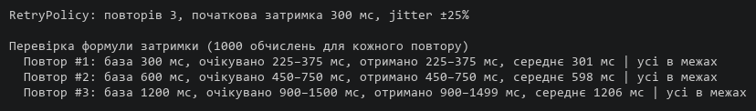
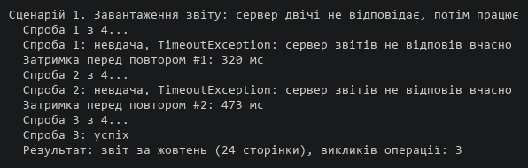
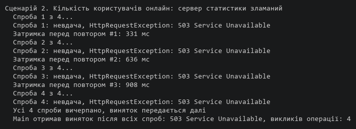
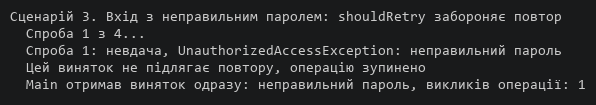

# Самостійна робота №20

Тема: реалізація exponential backoff.

В умові проєкт названо `IndependentWork14`, але ця назва в репозиторії вже зайнята чотирнадцятою роботою, тому проєкт називається `IndependentWork20`.

## Клас RetryPolicy

Клас має приватні поля `_maxRetries`, `_initialDelay`, `_jitterFactor` і конструктор `RetryPolicy(int maxRetries, TimeSpan initialDelay, double jitterFactor = 0.2)`. Конструктор перевіряє параметри: кількість повторів не може бути від'ємною, а jitter має бути від 0 до 1, бо інакше затримка могла б стати від'ємною.

Метод `Execute<T>` узагальнений, тому одна політика працює з будь-якою операцією `Func<T>`. У `Main` вона виконує операції, що повертають `string`, `int` і `bool`. Кожна спроба, затримка і причина невдачі виводяться в консоль.

Затримка рахується за формулою з умови:

```csharp
public TimeSpan CalculateDelay(int retryAttempt)
{
    double jitter = 1 + _random.NextDouble() * _jitterFactor * 2 - _jitterFactor;
    return _initialDelay * Math.Pow(2, retryAttempt) * jitter;
}
```

`shouldRetry` вирішує, чи повторювати спробу для конкретного винятку. Якщо він повертає `false`, або спроби вичерпано, виняток передається далі через `throw;`, тож зберігається його початковий стек викликів:

```csharp
if (shouldRetry is not null && !shouldRetry(exception))
{
    Console.WriteLine("  Цей виняток не підлягає повтору, операцію зупинено");
    throw;
}

if (retryAttempt >= _maxRetries)
{
    Console.WriteLine($"  Усі {totalAttempts} спроби вичерпано, виняток передається далі");
    throw;
}
```

## Демонстрація

Я обрав такі параметри: 3 повтори (усього 4 спроби), початкова затримка 300 мс, jitter ±25%.

**Перевірка формули.** Для кожного повтору затримка обчислюється 1000 разів. Базова затримка подвоюється (300 → 600 → 1200 мс), а випадкові значення не виходять за межі ±25% від неї:



**Сценарій 1: успіх після кількох спроб.** Сервер звітів двічі не відповідає, а на третю спробу звіт завантажується:



**Сценарій 2: остаточна невдача.** Сервер статистики зламаний. Політика робить усі 4 спроби з дедалі більшими затримками, а потім передає виняток у `Main`, де його перехоплює `catch`:



**Сценарій 3: `shouldRetry` забороняє повтор.** Повторюються лише `TimeoutException` і `HttpRequestException`. Неправильний пароль від повтору не стане правильним, тому `UnauthorizedAccessException` передається далі одразу, після першої ж спроби:



## Висновок: межі застосування Retry з exponential backoff

Retry з експоненційною затримкою доречний для **тимчасових** збоїв, які зникають самі: сервер перевантажений або перезапускається, обірвалося мережеве з'єднання, спрацював ліміт запитів. Затримка, що росте, дає сервісу час відновитися і не засипає його запитами. Jitter не дає багатьом клієнтам, що отримали помилку одночасно, і повторювати одночасно.

Але повтор не допоможе, а іноді й зашкодить:

- **постійні помилки:** неправильний пароль, некоректні дані, помилка в коді. Повтор лише затримає відповідь, тому такі винятки треба відсікати через `shouldRetry`, як у сценарії 3;
- **неідемпотентні операції** (оплата, відправлення листа, створення замовлення): якщо операція насправді виконалась, а загубилась лише відповідь, повтор виконає її вдруге. Повторювати їх можна тільки тоді, коли сервіс уміє розпізнати дублікат;
- **тривалий збій сервісу:** повтори кожного клієнта лише навантажують сервіс, який і так не працює. Тут краще підходить Circuit Breaker;
- **швидка відповідь важливіша:** експоненційна затримка росте дуже швидко. У сценарії 2 користувач чекав майже 2 секунди, щоб дізнатися про помилку, а з 6 повторами чекав би майже 20 секунд. Тому кількість повторів треба обмежувати, а для інтерактивних дій краще показати помилку раніше.
