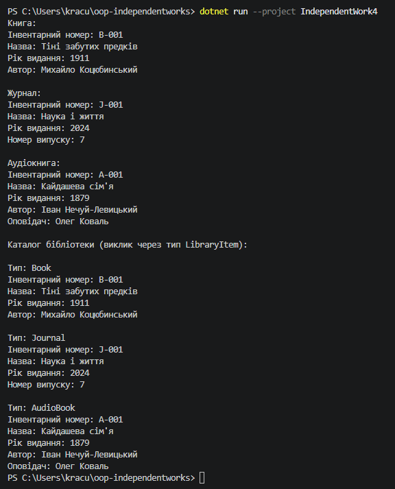

# Звіт до самостійної роботи №4

Тема: розширення ієрархії та наслідки змін базового класу.

## Що я зробив

Спочатку я створив початкову ієрархію: базовий клас `LibraryItem` і два похідні класи `Book` і `Journal`. У кожному похідному класі метод `DisplayDetails()` спочатку викликає `base.DisplayDetails()`, а потім дописує своє (автора або номер випуску). Я зібрав проєкт і перевірив, що все працює:

```text
Книга:
Назва: Тіні забутих предків
Рік видання: 1911
Автор: Михайло Коцюбинський

Журнал:
Назва: Наука і життя
Рік видання: 2024
Номер випуску: 7
```

Після цього я змінив базовий клас, а в кінці додав клас `AudioBook`.

## Зміни в базовому класі LibraryItem

У `LibraryItem` я додав:

- приватне поле `_uniqueId` (string);
- властивість `UniqueId` тільки для читання (є лише `get`);
- новий параметр `uniqueId` у конструкторі.

Конструктор був такий:

```csharp
public LibraryItem(string title, int publicationYear)
```

А став такий:

```csharp
public LibraryItem(string uniqueId, string title, int publicationYear)
```

Також я додав вивід інвентарного номера в `DisplayDetails()`.

## Які зміни довелося внести в похідні класи

Одразу після зміни `LibraryItem` я зібрав проєкт, нічого не чіпаючи в `Book` і `Journal`. Збірка не пройшла, з'явилися дві помилки:

```text
Book.cs(18,11): error CS7036: Отсутствует аргумент, соответствующий требуемому параметру "publicationYear" из "LibraryItem.LibraryItem(string, string, int)".
Journal.cs(18,11): error CS7036: Отсутствует аргумент, соответствующий требуемому параметру "publicationYear" из "LibraryItem.LibraryItem(string, string, int)".
```

Обидві помилки в рядку 18, де стоїть виклик `: base(title, publicationYear)`. Цікаво, що компілятор пише про відсутній `publicationYear`, а не `uniqueId`. Це тому, що він підставляє аргументи по порядку: `title` потрапляє на місце `uniqueId`, `publicationYear` на місце `title`, а для третього параметра аргументу вже немає.

Щоб це виправити, я змінив конструктори в обох класах. У `Book` було:

```csharp
public Book(string title, int publicationYear, string author)
    : base(title, publicationYear)
```

Стало:

```csharp
public Book(string uniqueId, string title, int publicationYear, string author)
    : base(uniqueId, title, publicationYear)
```

У `Journal` так само: додав параметр `uniqueId` і передав його в `base(...)`.

Після цього помилки в `Book` і `Journal` зникли, але з'явилися нові, вже в `Program.cs`:

```text
Program.cs(10,25): error CS7036: Отсутствует аргумент, соответствующий требуемому параметру "author" из "Book.Book(string, string, int, string)".
Program.cs(11,31): error CS7036: Отсутствует аргумент, соответствующий требуемому параметру "issueNumber" из "Journal.Journal(string, string, int, int)".
```

Тобто довелося ще й переписати всі місця, де створюються об'єкти `Book` і `Journal`, і передати їм інвентарний номер.

Методи `DisplayDetails()` у `Book` і `Journal` я не змінював. Вони викликають `base.DisplayDetails()`, тому номер почав виводитися в них автоматично.

## Чому ці зміни були потрібні

Коли створюється об'єкт `Book`, спочатку обов'язково викликається конструктор `LibraryItem`, бо частина даних книги (назва, рік, а тепер і номер) зберігається в базовому класі. У `LibraryItem` був лише один конструктор, і тепер він вимагає `uniqueId`. Сам `Book` цього номера не знає, тому мусить отримати його через свій конструктор і передати далі в `base(...)`.

Виходить ланцюжок: змінився конструктор базового класу, отже треба міняти конструктори всіх похідних класів, а потім ще й код, який ці об'єкти створює. У нашому прикладі всього два похідні класи, але якби їх було двадцять, довелося б правити двадцять файлів.

## Клас AudioBook

`AudioBook` я успадкував від `Book`, а не від `LibraryItem`, бо аудіокнига теж має автора. Завдяки цьому поле `_author` і його вивід не довелося писати ще раз.

```csharp
public AudioBook(string uniqueId, string title, int publicationYear, string author, string narrator)
    : base(uniqueId, title, publicationYear, author)
```

У завданні конструктор `AudioBook` вказаний без `uniqueId`, але після зміни базового класу без нього не обійтися. `Book` вимагає номер, тому `AudioBook` теж мусить його отримати і передати далі. Це ще один наслідок зміни з пункту 4.

`DisplayDetails()` в `AudioBook` викликає `base.DisplayDetails()` з `Book`, а той викликає версію з `LibraryItem`. Тому для аудіокниги виводиться все: номер, назва, рік, автор і оповідач.

Додавати `AudioBook` було набагато простіше, ніж змінювати `LibraryItem`. Я тільки створив новий файл, і жоден старий клас не довелося чіпати.

## Перевірка через поліморфізм

У `Main` я поклав усі три об'єкти в масив типу `LibraryItem[]` і для кожного викликав `DisplayDetails()`. Хоча змінна має тип `LibraryItem`, для книги виводиться автор, для журналу номер випуску, а для аудіокниги ще й оповідач. Отже `virtual` і `override` працюють правильно, і кожен клас виводить свою інформацію.

## Переваги і недоліки наслідування

Переваги, які я побачив у цій роботі:

- спільний код (назва, рік, номер) написаний один раз у `LibraryItem`, а не повторюється в кожному класі;
- новий тип (`AudioBook`) додається легко і не вимагає змін у старих класах;
- можна працювати з усіма елементами однаково через тип `LibraryItem`, як у моєму масиві.

Недоліки:

- похідні класи сильно залежать від базового: одна зміна конструктора в `LibraryItem` зламала `Book`, `Journal`, а потім і `Program.cs`;
- чим глибша ієрархія, тим довший ланцюжок. Зміна в `LibraryItem` зачіпає і `Book`, і `AudioBook`, хоча `AudioBook` наслідується від нього не напряму;
- ієрархію важко перебудувати. Наприклад, якщо з'явиться аудіожурнал, то незрозуміло, від чого його наслідувати: від `Journal` чи від `AudioBook`. C# не дозволяє наслідуватися від двох класів одразу.

## Наслідування чи композиція

Композиція означає, що клас не наслідується від іншого, а містить його об'єкт усередині як поле.

У цій задачі наслідування підходить для основної ієрархії, бо книга і журнал справді є бібліотечними елементами. Але для «аудіо» частини композиція була б кращою. Можна зробити окремий клас, наприклад `AudioRecording` з оповідачем і тривалістю, і додавати його як поле в будь-який клас: у книгу, у журнал чи в щось нове. Тоді не потрібні окремі класи `AudioBook` і `AudioJournal`, і не виникає проблеми, від кого наслідуватися.

Композиція краще захищає і від проблеми з пункту 4. Якщо зміниться клас, який використовується як поле, то міняти треба лише те місце, де він створюється, а не всю ієрархію.

Я вважаю, що наслідування варто використовувати, коли між класами є чіткий зв'язок «є» (книга є бібліотечним елементом) і базовий клас рідко змінюється. Якщо ж класи просто мають щось спільне або можливості треба комбінувати (аудіо, електронна версія, рідкісне видання), то краще використати композицію.

## Вивід програми

