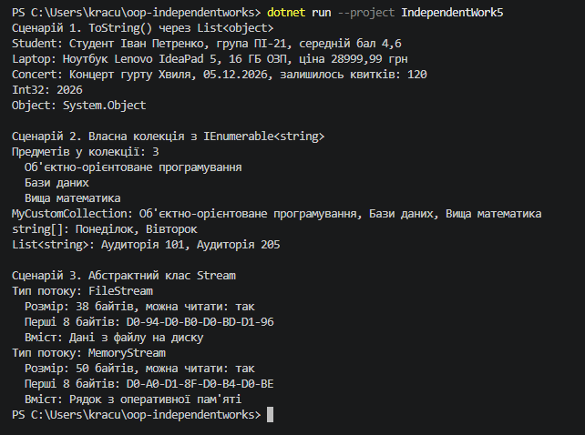

# Звіт до самостійної роботи №5

Тема: приклади поліморфізму в .NET.

У цій роботі я дослідив три випадки поліморфізму: через базовий клас `Object`, через інтерфейс `IEnumerable<string>` і через абстрактний клас `Stream`. Висновки я записував одразу після кожного сценарію.

## Сценарій 1. Поліморфізм через System.Object

Я створив три власні класи: `Student`, `Laptop` і `Concert`. Кожен з них неявно успадковується від `System.Object`, тому має метод `ToString()`. У кожному класі я його перевизначив, наприклад у `Student`:

```csharp
public override string ToString()
{
    return $"Студент {FullName}, група {Group}, середній бал {AverageGrade:F1}";
}
```

Потім я поклав об'єкти в `List<object>`. Для порівняння я додав туди ще число `2026` і звичайний `new object()`:

```csharp
List<object> items = new List<object>
{
    new Student("Іван Петренко", "ПІ-21", 4.6),
    new Laptop("Lenovo IdeaPad 5", 16, 28999.99m),
    new Concert("Хвиля", new DateTime(2026, 12, 5), 120),
    2026,
    new object()
};

foreach (object item in items)
{
    Console.WriteLine($"{item.GetType().Name}: {item}");
}
```

**Яка реалізація ToString() викликається.** Змінна `item` має тип `object`, але викликається не `ToString()` з `Object`, а версія того класу, яким об'єкт є насправді. Для `Student` виводиться інформація про студента, для `Laptop` про ноутбук. Число `2026` має власний `ToString()` у типі `Int32`, тому виводиться просто число. А для `new object()` нічого не перевизначено, тому спрацювала стандартна реалізація, яка повертає назву типу `System.Object`. Так було б і з моїми класами, якби я не написав `override`.

**Переваги.** Один і той самий рядок `Console.WriteLine($"... {item}")` працює з будь-якими об'єктами, і мені не треба писати окремий вивід для кожного класу. Якщо я додам новий клас з `ToString()`, цикл не доведеться змінювати.

## Сценарій 2. Поліморфізм через IEnumerable<string>

Я створив клас `MyCustomCollection`. Всередині він зберігає приватний `List<string>` і реалізує інтерфейс `IEnumerable<string>`. Щоб колекцію можна було перебирати через `foreach`, я реалізував метод `GetEnumerator()`:

```csharp
public class MyCustomCollection : IEnumerable<string>
{
    private List<string> _items;

    public IEnumerator<string> GetEnumerator()
    {
        foreach (string item in _items)
        {
            yield return item;
        }
    }

    IEnumerator IEnumerable.GetEnumerator()
    {
        return GetEnumerator();
    }
}
```

`yield return` віддає елементи по одному, і C# сам створює для цього об'єкт-перелічувач. Другий метод потрібен, бо `IEnumerable<string>` успадковується від старого неузагальненого `IEnumerable`, і його теж треба реалізувати. Я просто викликаю в ньому перший метод.

Ще я додав метод `Add`, який не приймає порожні рядки. Через те що список `_items` приватний, обійти цю перевірку не можна.

```csharp
MyCustomCollection subjects = new MyCustomCollection();
subjects.Add("Об'єктно-орієнтоване програмування");
subjects.Add("Бази даних");
subjects.Add("Вища математика");
subjects.Add("   ");

foreach (string subject in subjects)
{
    Console.WriteLine($"  {subject}");
}
```

Рядок з пробілами не додався, тому в колекції 3 предмети.

Щоб показати поліморфізм ще наочніше, я написав метод, який приймає параметр типу `IEnumerable<string>`, і передав у нього три різні колекції:

```csharp
static void PrintAll(string title, IEnumerable<string> collection)
{
    Console.WriteLine($"{title}: {string.Join(", ", collection)}");
}

PrintAll("MyCustomCollection", subjects);
PrintAll("string[]", days);
PrintAll("List<string>", rooms);
```


**Як тут проявляється поліморфізм.** `foreach`, `string.Join` і мій `PrintAll` не знають, що саме їм передали: масив, список чи мою колекцію. Їм потрібно тільки те, щоб об'єкт реалізовував `IEnumerable<string>`, тобто мав `GetEnumerator()`. Кожен тип перебирає свої елементи по-своєму, а код, який їх використовує, однаковий.

**Переваги.** Моя колекція одразу запрацювала з `foreach` і `string.Join`, хоча я їх не змінював. Крім того, зовнішній код не бачить внутрішній `List<string>`. Я можу замінити його на масив чи щось інше, і `foreach` у `Main` продовжить працювати.

## Сценарій 3. Поліморфізм через абстрактний клас Stream

`Stream` є абстрактним класом. Створити його об'єкт напряму не можна, але від нього успадковуються `FileStream` (дані з файлу) і `MemoryStream` (дані в пам'яті). Я написав метод, який приймає параметр типу `Stream`:

```csharp
static void ProcessStream(Stream stream)
{
    Console.WriteLine($"Тип потоку: {stream.GetType().Name}");
    Console.WriteLine($"  Розмір: {stream.Length} байтів, можна читати: {(stream.CanRead ? "так" : "ні")}");

    byte[] firstBytes = new byte[8];
    int bytesRead = stream.Read(firstBytes, 0, firstBytes.Length);
    Console.WriteLine($"  Перші {bytesRead} байтів: {BitConverter.ToString(firstBytes, 0, bytesRead)}");

    stream.Position = 0;
    byte[] allBytes = new byte[stream.Length];
    stream.ReadExactly(allBytes);
    Console.WriteLine($"  Вміст: {Encoding.UTF8.GetString(allBytes)}");
}
```

Тестовий файл програма створює сама через `File.WriteAllText`, тому вона не залежить від зовнішніх файлів. Файл лежить поруч із виконуваним файлом програми.

```csharp
string filePath = Path.Combine(AppContext.BaseDirectory, "test.txt");
File.WriteAllText(filePath, "Дані з файлу на диску");

byte[] memoryData = Encoding.UTF8.GetBytes("Рядок з оперативної пам'яті");

using (FileStream fileStream = new FileStream(filePath, FileMode.Open, FileAccess.Read))
using (MemoryStream memoryStream = new MemoryStream(memoryData))
{
    ProcessStream(fileStream);
    ProcessStream(memoryStream);
}
```

Розмір у байтах більший, ніж кількість літер, бо в кодуванні UTF-8 кожна українська літера займає 2 байти.

**Як тут проявляється поліморфізм.** `ProcessStream` викликає `Length`, `Read`, `Position` і `ReadExactly`, які оголошені в `Stream`. А виконується реалізація конкретного класу: `FileStream` читає з диска через операційну систему, `MemoryStream` просто копіює байти з масиву в пам'яті. Метод про це нічого не знає, і один і той самий код працює з обома.

**Переваги.** Мені не треба писати окремі методи `ProcessFile` і `ProcessMemory`. `ProcessStream` так само працюватиме з мережевим потоком, стисненим `GZipStream` чи будь-яким іншим нащадком `Stream`, і змінювати його не доведеться. Ще це зручно для тестування: замість справжнього файлу можна передати `MemoryStream` з тестовими даними.

## Загальні висновки

У всіх трьох сценаріях працює одна ідея: код пишеться для загального типу (`object`, `IEnumerable<string>`, `Stream`), а під час виконання викликається реалізація конкретного об'єкта.

Ці три випадки відрізняються тим, як задається загальний тип:

- `Object` є звичайним базовим класом з віртуальними методами, і їх можна перевизначити через `override`;
- `IEnumerable<string>` є інтерфейсом. Він тільки каже, які методи мають бути, а як їх написати, вирішує кожен клас сам;
- `Stream` є абстрактним класом. Він містить і готовий код (наприклад `ReadExactly`), і абстрактні методи, які нащадки зобов'язані реалізувати.

Головна перевага поліморфізму, яку я побачив: можна додати новий тип (свій клас, свою колекцію, новий вид потоку), і старий код (`Console.WriteLine`, `foreach`, `ProcessStream`) працюватиме з ним без змін.

## Повний вивід програми
