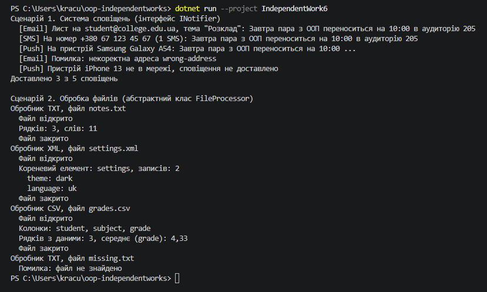

# Звіт до самостійної роботи №6

Тема: інтерфейс vs абстрактний клас, практичні критерії.

Перед тим як писати код, я для кожного сценарію відповів собі на кілька питань. Чи є у класів спільний код, який не хочеться повторювати? Чи пов'язані ці класи між собою, тобто чи можна сказати, що один «є різновидом» іншого? Чи може класу знадобитися ще якийсь базовий клас або інша роль? Відповіді на ці питання і визначили мій вибір.

## Сценарій 1: Система сповіщень

### Обраний підхід: Інтерфейс `INotifier`

### Обґрунтування вибору:

У цьому сценарії краще використовувати інтерфейс `INotifier`, оскільки:

1. **Немає спільного коду.** Email, SMS і Push відправляють повідомлення зовсім по-різному. Пошті потрібна адреса і тема, SMS ділить довгий текст на частини, Push перевіряє, чи пристрій у мережі, і обрізає текст. Спільне в них тільки те, що є метод `Send(string message)`. Саме це і описує інтерфейс: що клас вміє робити, а не як.
2. **Канали між собою не пов'язані.** SMS не є різновидом пошти, а Push не є різновидом SMS. Їх об'єднує лише вміння відправити повідомлення, а не спільне походження.
3. **Клас може мати й інші ролі.** Клас може реалізувати кілька інтерфейсів одночасно, наприклад бути і сповіщувачем, і логером. А успадковуватися в C# можна тільки від одного класу. Якщо, наприклад, `PushNotifier` колись доведеться успадкувати від класу якоїсь бібліотеки для роботи з телефонами, з інтерфейсом це не буде проблемою.
4. **Слабке зв'язування.** Код, який відправляє сповіщення, залежить лише від `INotifier`. Можна додати Telegram чи Viber, і цей код змінювати не доведеться.

### Чому абстрактний клас тут гірший:

Якби я зробив абстрактний клас `Notifier`, у ньому не було б чого написати, крім абстрактного методу `Send`, бо спільної логіки немає. Тоді він нічим не кращий за інтерфейс, а обмеження з'являється: класи-канали вже не зможуть успадкуватися ні від чого іншого.

### Реалізація:

```csharp
// Інтерфейс
public interface INotifier
{
    string ChannelName { get; }

    bool Send(string message);
}
```

Я додав у інтерфейс властивість `ChannelName`, щоб у виводі було видно канал. Метод `Send` повертає `bool`, щоб було зрозуміло, чи вдалося відправити.

```csharp
// Реалізація 1: пошта перевіряє адресу
public class EmailNotifier : INotifier
{
    private string _emailAddress;
    private string _subject;

    public bool Send(string message)
    {
        if (!_emailAddress.Contains('@'))
        {
            Console.WriteLine($"  [{ChannelName}] Помилка: некоректна адреса {_emailAddress}");
            return false;
        }

        Console.WriteLine($"  [{ChannelName}] Лист на {_emailAddress}, тема \"{_subject}\": {message}");
        return true;
    }
}

// Реалізація 2: SMS рахує, на скільки частин ділиться текст
public class SmsNotifier : INotifier
{
    private const int MaxSegmentLength = 70;

    public bool Send(string message)
    {
        int segments = (int)Math.Ceiling((double)message.Length / MaxSegmentLength);
        _sentSegments += segments;

        Console.WriteLine($"  [{ChannelName}] На номер {_phoneNumber} ({segments} SMS): {message}");
        return true;
    }
}

// Реалізація 3: Push працює лише з пристроєм у мережі і обрізає довгий текст
public class PushNotifier : INotifier
{
    public bool Send(string message)
    {
        if (!_isDeviceOnline)
        {
            Console.WriteLine($"  [{ChannelName}] Пристрій {_deviceName} не в мережі, сповіщення не доставлено");
            return false;
        }

        string preview = message.Length > MaxPreviewLength
            ? message.Substring(0, MaxPreviewLength) + "..."
            : message;

        Console.WriteLine($"  [{ChannelName}] На пристрій {_deviceName}: {preview}");
        return true;
    }
}
```

Тут показані тільки методи `Send`, повний код лежить у файлах [EmailNotifier.cs](EmailNotifier.cs), [SmsNotifier.cs](SmsNotifier.cs) і [PushNotifier.cs](PushNotifier.cs).

```csharp
// Демонстрація в Main
List<INotifier> notifiers = new List<INotifier>
{
    new EmailNotifier("student@college.edu.ua", "Розклад"),
    new SmsNotifier("+380 67 123 45 67"),
    new PushNotifier("Samsung Galaxy A54", true),
    new EmailNotifier("wrong-address", "Розклад"),
    new PushNotifier("iPhone 13", false)
};

int delivered = 0;
foreach (INotifier notifier in notifiers)
{
    if (notifier.Send(message))
    {
        delivered++;
    }
}
```

Результат:

```text
  [Email] Лист на student@college.edu.ua, тема "Розклад": Завтра пара з ООП переноситься на 10:00 в аудиторію 205
  [SMS] На номер +380 67 123 45 67 (1 SMS): Завтра пара з ООП переноситься на 10:00 в аудиторію 205
  [Push] На пристрій Samsung Galaxy A54: Завтра пара з ООП переноситься на 10:00 ...
  [Email] Помилка: некоректна адреса wrong-address
  [Push] Пристрій iPhone 13 не в мережі, сповіщення не доставлено
Доставлено 3 з 5 сповіщень
```

Цикл викликає той самий `Send`, але кожен канал поводиться по-своєму. Я спеціально додав неправильну адресу і пристрій не в мережі, щоб було видно, що кожна реалізація має свої перевірки.

## Сценарій 2: Обробка файлів

### Обраний підхід: Абстрактний клас `FileProcessor`

### Обґрунтування вибору:

У цьому сценарії краще використовувати абстрактний клас `FileProcessor`, оскільки:

1. **Є спільні кроки.** Будь-який файл треба відкрити, перевірити, що він існує, прочитати і обов'язково закрити, навіть якщо сталася помилка. Цей код однаковий для всіх типів файлів. В абстрактному класі я написав його один раз, а в інтерфейсі так зробити не можна, бо інтерфейс описує лише, які методи мають бути.
2. **Однаковий порядок дій.** Метод `Process()` у базовому класі задає послідовність: відкрити, обробити, закрити. Нащадки не можуть її змінити або забути закрити файл, бо `Process()` не віртуальний, а `Open()` і `Close()` приватні.
3. **Нащадки зобов'язані дописати свою частину.** Метод `ProcessContent` абстрактний, тому компілятор не дозволить створити обробник, який не вміє обробляти вміст.
4. **Класи справді пов'язані.** Обробник TXT, XML чи CSV є різновидом обробника файлів, тобто тут є зв'язок «є».

### Чому інтерфейс тут гірший:

Якби я зробив інтерфейс `IFileProcessor` з методом `Process()`, то кожен клас мусив би сам писати відкриття, перевірку і закриття файлу. Код повторювався б тричі. А якщо в одному класі забути закрити файл, він залишиться заблокованим. Абстрактний клас від цього захищає.

### Реалізація:

```csharp
// Абстрактний клас
public abstract class FileProcessor
{
    private string _filePath;
    private StreamReader? _reader;

    public abstract string FileType { get; }

    protected FileProcessor(string filePath)
    {
        _filePath = filePath;
    }

    // Загальний порядок обробки однаковий для всіх файлів
    public void Process()
    {
        Console.WriteLine($"Обробник {FileType}, файл {Path.GetFileName(_filePath)}");

        if (!Open())
        {
            return;
        }

        try
        {
            string content = _reader!.ReadToEnd();
            ProcessContent(content);
        }
        finally
        {
            Close();
        }
    }

    private bool Open()
    {
        if (!File.Exists(_filePath))
        {
            Console.WriteLine("  Помилка: файл не знайдено");
            return false;
        }

        _reader = new StreamReader(_filePath);
        Console.WriteLine("  Файл відкрито");
        return true;
    }

    private void Close()
    {
        _reader?.Dispose();
        _reader = null;
        Console.WriteLine("  Файл закрито");
    }

    // Унікальна логіка, яку кожен нащадок зобов'язаний реалізувати
    protected abstract void ProcessContent(string content);
}
```

`try` і `finally` потрібні, щоб файл закрився навіть тоді, коли в `ProcessContent` станеться помилка. Конструктор `protected`, бо створювати об'єкт абстрактного класу напряму не можна, його викликають тільки нащадки.

```csharp
// Реалізація 1: текстовий файл, рахує рядки і слова
public class TextFileProcessor : FileProcessor
{
    public override string FileType
    {
        get { return "TXT"; }
    }

    public TextFileProcessor(string filePath)
        : base(filePath)
    {
    }

    protected override void ProcessContent(string content)
    {
        string[] lines = content.Split('\n', StringSplitOptions.RemoveEmptyEntries);
        string[] words = content.Split(new[] { ' ', '\n', '\r' }, StringSplitOptions.RemoveEmptyEntries);

        Console.WriteLine($"  Рядків: {lines.Length}, слів: {words.Length}");
    }
}

// Реалізація 2: XML-файл, виводить записи
public class XmlFileProcessor : FileProcessor
{
    protected override void ProcessContent(string content)
    {
        XDocument document = XDocument.Parse(content);
        XElement root = document.Root!;

        Console.WriteLine($"  Кореневий елемент: {root.Name}, записів: {root.Elements().Count()}");
        foreach (XElement element in root.Elements())
        {
            Console.WriteLine($"    {element.Attribute("name")?.Value}: {element.Value}");
        }
    }
}
```

Третій обробник [CsvFileProcessor](CsvFileProcessor.cs) рахує середнє значення в останній колонці таблиці. У жодному з нащадків немає коду відкриття чи закриття файлу, тільки обробка вмісту.

```csharp
// Демонстрація в Main
List<FileProcessor> processors = new List<FileProcessor>
{
    new TextFileProcessor(textPath),
    new XmlFileProcessor(xmlPath),
    new CsvFileProcessor(csvPath),
    new TextFileProcessor(Path.Combine(folder, "missing.txt"))
};

foreach (FileProcessor processor in processors)
{
    processor.Process();
}
```

Тестові файли програма створює сама через `File.WriteAllText`, тому вона не залежить від зовнішніх файлів.

Результат:

```text
Обробник TXT, файл notes.txt
  Файл відкрито
  Рядків: 3, слів: 11
  Файл закрито
Обробник XML, файл settings.xml
  Файл відкрито
  Кореневий елемент: settings, записів: 2
    theme: dark
    language: uk
  Файл закрито
Обробник CSV, файл grades.csv
  Файл відкрито
  Колонки: student, subject, grade
  Рядків з даними: 3, середнє (grade): 4,33
  Файл закрито
Обробник TXT, файл missing.txt
  Помилка: файл не знайдено
```

Для кожного файлу «Файл відкрито» і «Файл закрито» виводить базовий клас, а рядок посередині виводить конкретний нащадок. Останній файл я навмисно не створював. Перевірку на відсутній файл написано один раз у `FileProcessor`, і вона працює для всіх обробників.

## Загальні висновки


Після цих двох сценаріїв я склав для себе такі критерії вибору.

Інтерфейс краще, якщо:

- у класів немає спільного коду, а спільне тільки те, що вони вміють робити (наприклад, відправляти повідомлення);
- класи між собою не пов'язані і можуть мати різних предків;
- класу може знадобитися кілька ролей одночасно, бо інтерфейсів можна реалізувати скільки завгодно;
- треба, щоб клієнтський код залежав від мінімального контракту і легко приймав нові реалізації.

Абстрактний клас краще, якщо:

- у нащадків є спільний код або спільні поля, і їх не хочеться повторювати;
- треба задати однаковий порядок дій, який нащадки не можуть порушити, а вони лише дописують свої кроки;
- класи справді є різновидами одного поняття (зв'язок «є»);
- потрібні конструктор, приватні поля, `protected` члени, яких в інтерфейсі бути не може.

В обох сценаріях працює поліморфізм: я створюю колекцію базового типу (`List<INotifier>` або `List<FileProcessor>`), кладу туди різні об'єкти і викликаю один метод. Код у циклі однаковий, а поведінка залежить від конкретного класу. Отже і інтерфейс, і абстрактний клас дають поліморфізм. Різниця в тому, чи є що успадковувати, крім самого контракту.

Мій вибір збігся з рекомендацією з методички: для сповіщень інтерфейс, для файлів абстрактний клас.
