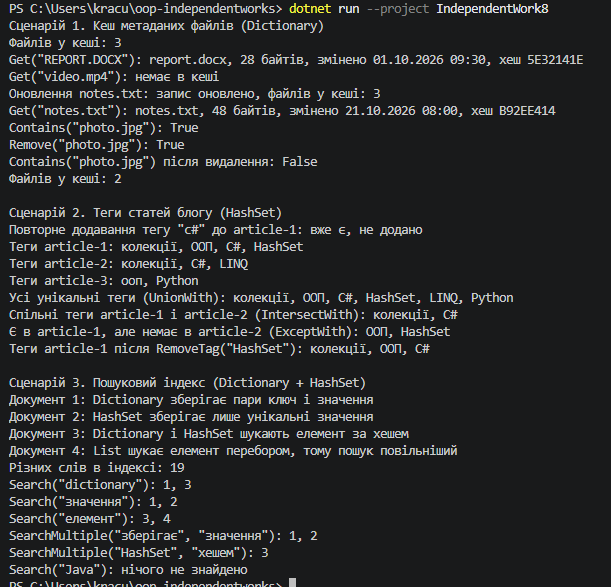

# Самостійна робота №8

Тема: вивчення `Dictionary<TKey, TValue>` та `HashSet<T>` у бібліотеках .NET.

Аналіз прикладів з open-source проєктів, порівняльна таблиця і висновки є у файлі [REPORT.md](REPORT.md).

## Що є в проєкті

- `FileMetadata.cs` і `FileMetadataCache.cs`: сценарій 1, кеш метаданих файлів на основі `Dictionary<string, FileMetadata>` з методами `Add`, `Get`, `Remove`, `Contains`.
- `TagManager.cs`: сценарій 2, теги статей блогу на основі `Dictionary<string, HashSet<string>>` з операціями `UnionWith`, `IntersectWith`, `ExceptWith`.
- `SearchIndex.cs`: сценарій 3, інвертований пошуковий індекс на основі `Dictionary<string, HashSet<int>>` з пошуком за одним і кількома словами.
- `Program.cs`: демонстрація всіх трьох сценаріїв.

## Запуск

```bash
dotnet run --project IndependentWork8
```

## Приклад виводу програми

