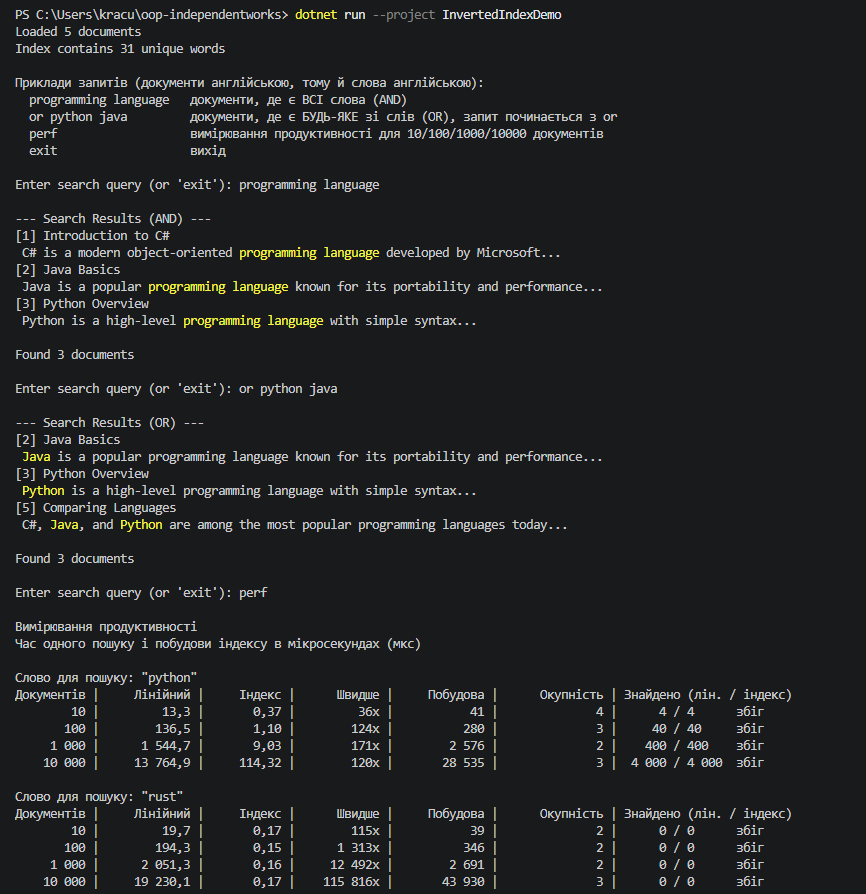

# InvertedIndexDemo

Самостійна робота №10: інвертований індекс для повнотекстового пошуку і порівняння його швидкості з лінійним пошуком.

Опис реалізації, таблиця вимірювань і висновки є у файлі [REPORT.md](REPORT.md).

## Що є в проєкті

- `Document.cs`: документ (`Id`, `Title`, `Content`).
- `TextProcessor.cs`: розбиття тексту на слова і видалення стоп-слів.
- `InvertedIndex.cs`: індекс на основі `Dictionary<string, HashSet<int>>` з пошуком за одним словом, за всіма словами (AND) і за будь-яким словом (OR).
- `SampleData.cs`: тестові документи і генератор великих наборів.
- `PerformanceTest.cs`: вимірювання продуктивності для 10, 100, 1000 і 10000 документів.
- `Program.cs`: інтерактивний пошук.

## Запуск

Програма чекає на запити з клавіатури:

- `programming language` знаходить документи, де є всі слова (AND);
- `or python java` знаходить документи, де є будь-яке зі слів (OR);
- `perf` запускає вимірювання продуктивності;
- `exit` завершує програму.

## Приклад виводу програми

