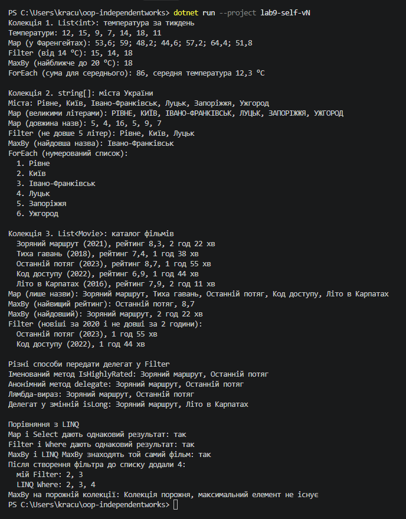

# Самостійна робота №9

Тема: делегати й лямбда-вирази, власні утиліти для колекцій.
---

### 1. Чому делегати корисні для створення таких утиліт?

Делегат дозволяє передати в метод не дані, а поведінку, тобто шматок коду, який метод викличе сам.

Якщо подивитися на `Filter`, то цикл, перевірка і додавання в результат там завжди однакові. Змінюється тільки умова. Без делегатів довелося б писати окремі методи `FilterWarmDays`, `FilterShortNames`, `FilterRecentMovies` і так далі, які відрізняються одним рядком. А з делегатом `Predicate<T>` метод один, і умову передає той, хто його викликає.

Делегати разом з узагальненими типами роблять метод універсальним. `T` каже «працюю з будь-яким типом», а делегат каже «роблю з ним те, що мені передали». У моїй програмі один і той самий `Filter` фільтрує числа, рядки і фільми.

Кожен метод використовує той делегат, який підходить за змістом:

- `Func<TSource, TResult>` у `Map` і `Func<T, TKey>` у `MaxBy` приймають елемент і повертають результат;
- `Predicate<T>` у `Filter` приймає елемент і повертає `bool`, тобто відповідає на питання «так чи ні»;
- `Action<T>` у `ForEach` приймає елемент і нічого не повертає, просто виконує дію.

### 2. Як лямбда-вирази спрощують виклик цих методів?

У програмі я передав ту саму умову в `Filter` чотирма способами:

```csharp
// 1. Іменований метод: треба окремо оголосити метод десь у класі
CollectionUtils.Filter(movies, IsHighlyRated);

// 2. Анонімний метод: довгий запис зі словом delegate і типом параметра
CollectionUtils.Filter(movies, delegate (Movie m) { return m.Rating >= 8.0; });

// 3. Лямбда-вираз: найкоротший запис
CollectionUtils.Filter(movies, m => m.Rating >= 8.0);

// 4. Лямбда в змінній: можна використати кілька разів
Predicate<Movie> isLong = m => m.DurationMinutes > 130;
```

Результат у всіх однаковий, але лямбда найкоротша і найзрозуміліша. Умова записана прямо там, де вона потрібна, і не треба шукати окремий метод. Тип параметра `m` писати не треба, компілятор сам розуміє, що це `Movie`.

Ще лямбда може використовувати змінні з методу, в якому її написали. Це називається замикання. Я використав це двічі:

```csharp
int sum = 0;
CollectionUtils.ForEach(temperatures, t => sum += t);

int number = 1;
CollectionUtils.ForEach(cities, c => Console.WriteLine($"  {number++}. {c}"));
```

Лямбда змінює `sum` і `number`, хоча вони оголошені поза нею. З іменованим методом так просто не вийшло б, довелося б робити ці змінні полями класу.

Якщо умова складніша, лямбда може мати блок коду в фігурних дужках:

```csharp
CollectionUtils.Filter(movies, m =>
{
    bool isRecent = m.Year >= 2020;
    bool fitsInEvening = m.DurationMinutes <= 120;
    return isRecent && fitsInEvening;
});
```

### 3. Порівняння з LINQ

Мої методи відповідають таким операторам LINQ:

- `Map` відповідає `Select`;
- `Filter` відповідає `Where`;
- `MaxBy` відповідає `MaxBy` (з'явився в .NET 6);
- `ForEach` у LINQ немає. Є `List<T>.ForEach`, але тільки для списків, а мій працює з будь-якою колекцією, навіть з масивом.

У програмі я перевірив, що на тих самих даних результати однакові: `Map` і `Select`, `Filter` і `Where`, мій `MaxBy` і LINQ `MaxBy` дають те саме.

Але є і різниці, які я помітив:

1. **Коли виконується код.** Мої `Map` і `Filter` одразу проходять колекцію і складають результат у новий `List`. LINQ `Select` і `Where` нічого не роблять одразу, а виконуються тільки тоді, коли результат почнуть перебирати. Це називається відкладене виконання. Я показав це в програмі: створив фільтр, потім додав у список число 4, і тільки потім вивів результат. Мій `Filter` число 4 не побачив, а LINQ `Where` побачив, бо перебирав список уже після додавання.
2. **Пам'ять.** Через те що мої методи створюють новий `List`, вони займають додаткову пам'ять. LINQ віддає елементи по одному і окремий список не створює. Для великих колекцій це важливо.
3. **Ланцюжки.** LINQ-методи є методами розширення, тому їх можна писати ланцюжком: `movies.Where(...).Select(...)`. Мої методи треба вкладати один в одного: `CollectionUtils.Map(CollectionUtils.Filter(movies, ...), ...)`, і це читається гірше. Щоб писати ланцюжком, треба було б зробити параметр `this IEnumerable<T> collection`.
4. **Порожня колекція в MaxBy.** Мій `MaxBy` завжди викидає виняток. LINQ `MaxBy` для класів (як `Movie`) повертає `null`, а виняток викидає лише для типів-значень (як `int`).
5. **Тип умови.** У `Where` умова має тип `Func<T, bool>`, а в моєму `Filter` тип `Predicate<T>`. За змістом це одне й те саме, але це різні типи делегатів, і змінну одного типу не можна просто передати замість іншого.

**Висновок.** У реальних проєктах краще використовувати LINQ, бо він перевірений, ефективніший і зручніший у ланцюжках. Але написати такі методи самому корисно, щоб зрозуміти, що всередині LINQ немає нічого магічного: це звичайний цикл `foreach`, а вся гнучкість береться з делегатів. Власні утиліти мають сенс, коли потрібна поведінка, якої немає в LINQ. Наприклад, мій `ForEach` для будь-якої колекції або `MaxBy`, який завжди повідомляє про порожню колекцію.

## Приклад виводу програми

